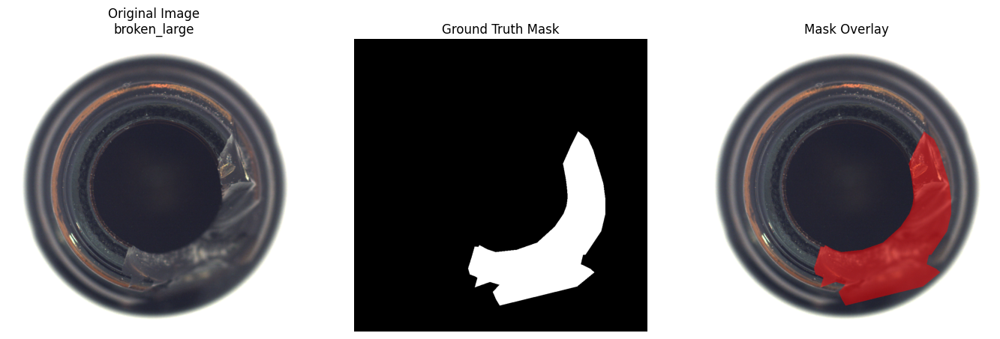
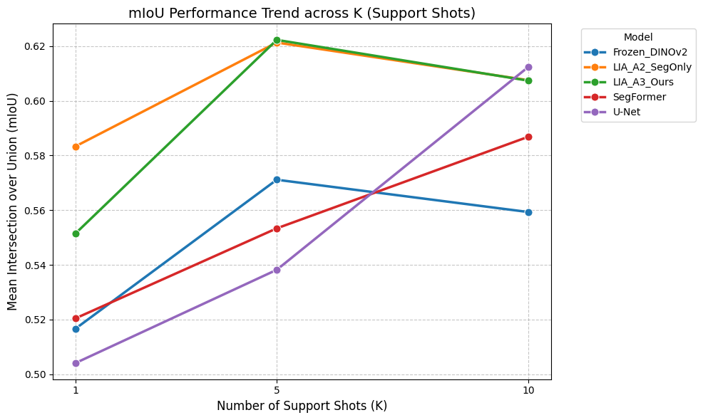
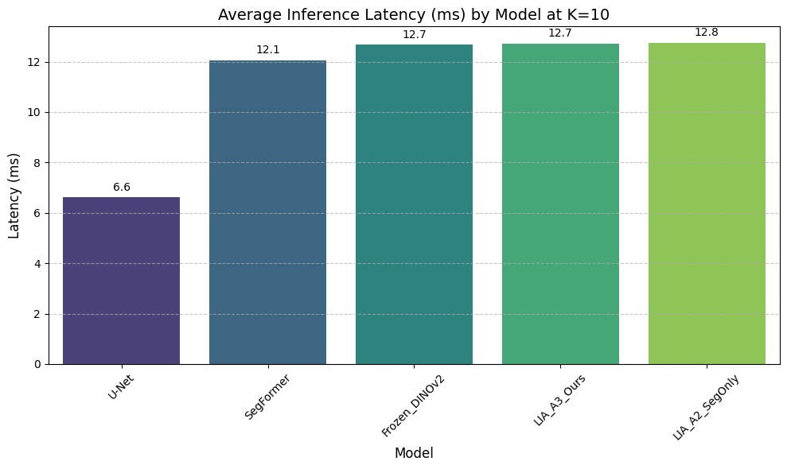
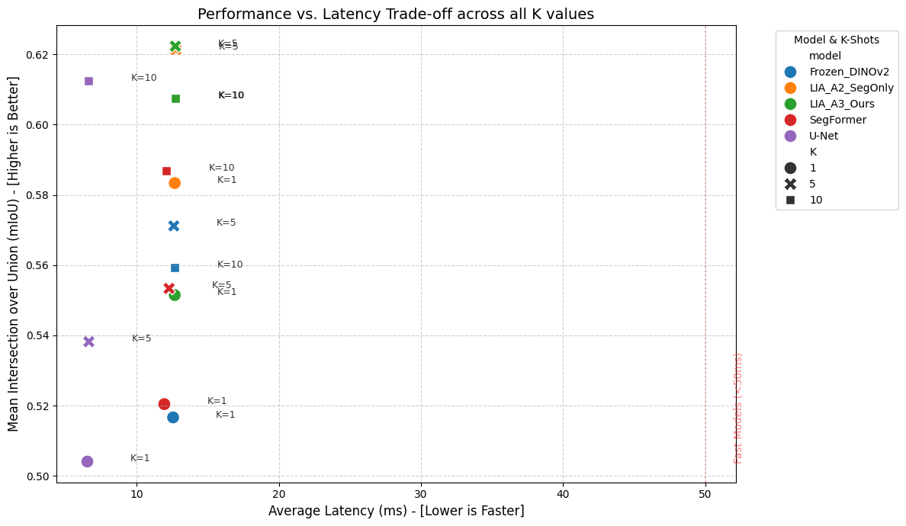
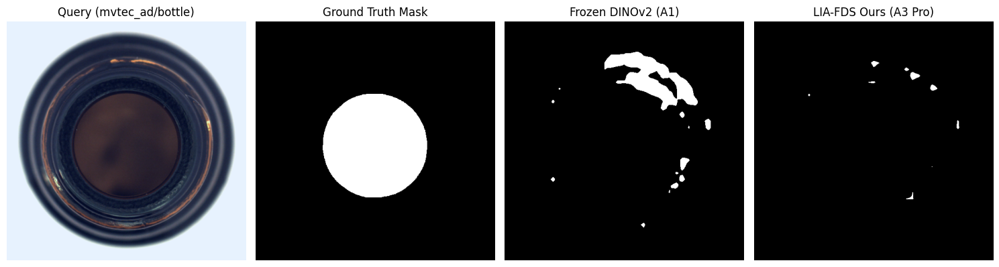

# LIA-FDS: Few-Shot Manufacturing & Food Defect Segmentation

## Project Overview

On manufacturing and food packaging lines, collecting thousands of defective images for every new product is difficult. This project tests whether useful defect segmentation is possible with only a few labeled examples. It compares U-Net, SegFormer, Frozen DINOv2, and an adapted DINOv2 (ViT-S/14) pipeline called LIA-FDS at 1-, 5-, and 10-shot settings.

The benchmark covers four categories: MVTec-AD `bottle` and `capsule`, plus VisA `cashew` and `fryum`. It is designed as a practical computer vision experiment that is easy to reproduce and discuss in an engineering interview.

## Key Highlights

- **Strong localization with just 5 images:** LIA-FDS reaches **97.40% Pixel AUROC** and **0.6223 mIoU**, compared with 5-shot U-Net at 69.29% AUROC / 0.5382 mIoU and SegFormer at 91.67% AUROC / 0.5534 mIoU.
- **Better few-shot defect overlap:** At K=5, Defect IoU is more than twice U-Net's result (**0.2803 vs. 0.1180**), and Pixel AP improves from **0.2640 to 0.5279**.
- **More stable under factory lighting changes:** With synthetic brightness and contrast shifts at K=5, LIA_A3_Ours keeps **96.66% AUROC** and **0.4819 AP**. U-Net reaches 0.1620 AP and SegFormer reaches 0.2592 AP.
- **Fast inference:** The adapted DINOv2 pipeline runs at about **12.7 ms per image**, or roughly **78 FPS**, on an NVIDIA L4 GPU.

## How It Works

1. **Feature backbone:** A frozen DINOv2 (ViT-S/14) processes 224 x 224 images and produces 16 x 16 patch features.
2. **LIA adapter:** A lightweight residual adapter is trained with episodic few-shot tasks to keep features stable when lighting changes.
3. **Prototype matching:** Query patches are compared with normal-background prototypes from K-Means and defective support prototypes.
4. **Quick support adaptation:** The pipeline performs 45 fine-tuning steps on the support set before evaluating query images.

## Results & Observations

### K=1, 5, 10 Benchmark

| K | Model | mIoU | Defect IoU | Pixel AUROC | Pixel AP | Latency (ms) |
|---:|---|---:|---:|---:|---:|---:|
| 1 | LIA_A2_SegOnly | 0.5833 | 0.2008 | 0.9503 | 0.4709 | 12.67 |
| 1 | LIA_A3_Ours | 0.5515 | 0.1402 | 0.9414 | 0.4327 | 12.67 |
| 1 | SegFormer | 0.5204 | 0.0823 | 0.8920 | 0.3016 | 9.57 |
| 1 | Frozen_DINOv2 | 0.5167 | 0.0726 | 0.9293 | 0.3401 | 12.42 |
| 1 | U-Net | 0.5041 | 0.0569 | 0.6400 | 0.1680 | 3.55 |
| 5 | LIA_A3_Ours | **0.6223** | **0.2803** | 0.9740 | **0.5279** | 12.72 |
| 5 | LIA_A2_SegOnly | 0.6213 | 0.2766 | **0.9765** | 0.5269 | 12.69 |
| 5 | Frozen_DINOv2 | 0.5712 | 0.1755 | 0.9613 | 0.4227 | 12.42 |
| 5 | SegFormer | 0.5534 | 0.1456 | 0.9167 | 0.3694 | 9.57 |
| 5 | U-Net | 0.5382 | 0.1180 | 0.6929 | 0.2640 | 3.54 |
| 10 | U-Net | 0.6124 | 0.2588 | 0.7198 | 0.3672 | 3.54 |
| 10 | LIA_A2_SegOnly | 0.6076 | 0.2643 | 0.9817 | 0.5215 | 12.68 |
| 10 | LIA_A3_Ours | 0.6074 | 0.2624 | **0.9833** | 0.5188 | 12.72 |
| 10 | SegFormer | 0.5869 | 0.2096 | 0.9412 | 0.4316 | 9.57 |
| 10 | Frozen_DINOv2 | 0.5593 | 0.1536 | 0.9675 | 0.4534 | 12.42 |

### K=5 Illumination Stress Test

This test uses seed 42 and applies brightness and contrast shifts to query images to simulate changing factory lighting.

| K | Model | mIoU | Defect IoU | Pixel AUROC | Pixel AP | Latency (ms) |
|---:|---|---:|---:|---:|---:|---:|
| 5 | LIA_A2_SegOnly | **0.5937** | **0.2341** | 0.9638 | 0.4671 | 12.57 |
| 5 | LIA_A3_Ours | 0.5907 | 0.2249 | **0.9666** | **0.4819** | 12.59 |
| 5 | Frozen_DINOv2 | 0.5407 | 0.1235 | 0.9498 | 0.3448 | 12.43 |
| 5 | SegFormer | 0.5306 | 0.1068 | 0.8845 | 0.2592 | 9.59 |
| 5 | U-Net | 0.5128 | 0.0685 | 0.6248 | 0.1620 | 3.54 |

### Practical Note on Metrics

Pixel AUROC is very high (97.4%–98.3%) because the model reliably separates defect and background regions. Defect IoU is naturally lower on tiny hairline scratches, especially in capsule and cashew images. DINOv2 predicts on a 16 x 16 patch grid and then upsamples the result to 224 x 224, so very thin boundaries are difficult to recover exactly.

## Visualizations











## How to Run

### Google Colab

1. Open `LIA_FDS_Final_Research_Notebook_v5_Pro.ipynb` in Google Colab.
2. Install the dependencies from `requirements.txt` in the first cell.
3. Mount Google Drive and point the notebook at the prepared MVTec-AD and VisA datasets.
4. Run the cells from top to bottom. The notebook caches checkpoints and experiment results where configured.

### Local

```bash
python -m venv .venv
# Windows:
.venv\Scripts\activate
# macOS/Linux:
# source .venv/bin/activate
pip install -r requirements.txt
jupyter notebook LIA_FDS_Final_Research_Notebook_v5_Pro.ipynb
```

The notebook expects the datasets and their masks to be available at the paths configured in the dataset setup cells. The included CSV files are the benchmark summaries, so the charts and README results can be reviewed without rerunning the full experiment.

## Project Files

- `LIA_FDS_Final_Research_Notebook_v5_Pro.ipynb`: end-to-end experiment notebook.
- `results/`: benchmark and illumination stress-test CSV files.
- `assets/`: plots and qualitative comparison images extracted from notebook outputs.
- `requirements.txt`: core Python dependencies.
